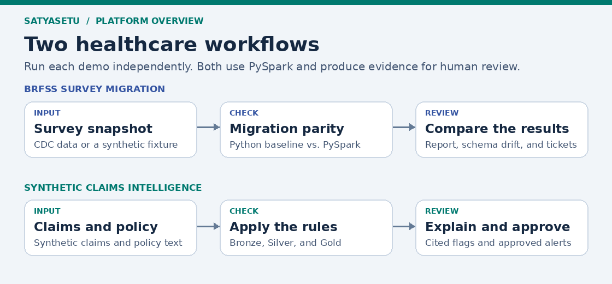

# SatyaSetu | Healthcare Data Assurance & Claims Intelligence

*The system changes. The meaning holds.*

SatyaSetu combines two runnable healthcare data engineering demos in one repository. **Survey migration assurance** checks whether a Databricks-style target preserves a CDC BRFSS dashboard metric. **Claims intelligence** uses synthetic claims and a fictional insurance policy to flag records for review, cite the policy, and prepare approval-gated notifications.

| Workflow | Try it | First output to open |
|---|---|---|
| BRFSS survey migration | [Migration guide, flow image, and code references](docs/brfss-migration.md) | `out/fixture/migration_report.md` |
| Synthetic claims intelligence | [Claims walkthrough and code references](docs/demo-walkthrough.md) | `out/claims/summary.json` and `claims explain C002` |
| Architecture and deployment | [Architecture](docs/architecture.md) · [Setup](docs/setup.md) | Local and optional Azure paths |

## Open the full application

The ZIP includes the **2023 and 2024 CDC BRFSS archives and both codebooks** in [data/raw/](data/raw/README.md). The portal can run the full survey workflow from those files.

~~~bash
python3 -m venv .venv
source .venv/bin/activate
python -m pip install -e '.[local,portal]'
satyasetu
~~~

Open [http://localhost:8080](http://localhost:8080) to launch runs, inspect claims, download evidence, and record review decisions. See the [portal guide](docs/portal.md) for Docker and verification, or the [Azure deployment guide](deployment/azure-portal/README.md) for a private Azure VM.

## Run both demos

From the repository root, with Python 3.11 or 3.12 and Java 17 or 21:

~~~bash
python3 -m venv .venv
source .venv/bin/activate
python -m pip install -e '.[local]'

brfss demo --fixture --out out/fixture
claims demo
claims explain C002
~~~

BRFSS should show **5 matching groups** after correction and **3 mismatches** in the deliberately defective fixture. The claims run should return **2 pass, 3 review, and 2 quarantined**. Claim C002 has coverage, late-filing, and amount flags. Its explanation cites all three sections of the fictional policy.

The full 2023 and 2024 public survey archives and codebooks are bundled under `data/raw/`. Run them from the portal or follow the [full CDC CLI instructions](docs/brfss-migration.md#run-the-cdc-files). Claims use fictional data generated for this demo.

## How the claims workflow fits together

1. [Bronze](src/healthcare/pipelines/bronze.py) reads the synthetic patients, encounters, and claims CSVs. [Quality checks](src/healthcare/quality/checks.py) check that source keys are unique.
2. [Silver](src/healthcare/pipelines/silver.py) joins the claim to its patient and encounter and checks whether the values can support a decision.
3. [Gold](src/healthcare/pipelines/gold.py) applies [deterministic rules](src/healthcare/rules/claim_rules.py) and writes one result per claim. `PASS`, `REVIEW`, and `QUARANTINED` have distinct meanings.
4. [Policy retrieval](src/healthcare/rag/retrieve.py) looks up the rule evidence. [Agent tools](agent/README.md) can use the same evidence to explain a decision.
5. A human reviewer [drafts and approves the notification](docs/demo-walkthrough.md#review-a-notification) before it enters the delivery queue.

See the [business rules](docs/business-rules.md) and [data model](docs/data-model.md) for the exact thresholds, keys, joins, and output fields.

## Repository structure

~~~text
satyasetu/
├── README.md
├── pyproject.toml              # brfss and claims entry points
├── .github/workflows/ci.yml    # Runs both fixtures and local tests
├── docs/                       # Architecture, images, models, and walkthroughs
├── config/                     # BRFSS target schema and mappings
├── examples/                   # BRFSS migration and report-change requests
├── data/raw/                   # Four original CDC survey and codebook ZIPs
├── data/sample/                # Survey fixtures and claims/ with fictional policy
├── scripts/                    # Synthetic claims data generator
├── src/
│   ├── brfss_assurance/         # Survey ingestion, parity, evidence, and tickets
│   ├── healthcare/             # Claims pipelines, quality, rules, RAG, and notifications
│   └── satyasetu_portal/       # Browser UI, run history, and approval forms
├── cloud/                      # Existing BRFSS Databricks, Agent Bricks, and Logic Apps
├── agent/                      # Claims tools and instructions for a hosted assistant
├── notebooks/                  # Explore and run the claims workflow in Databricks
├── sql/                        # Claims reporting views
├── deployment/                 # Azure portal, Databricks upload, and Logic Apps
├── evaluation/                 # Offline policy retrieval evaluation
└── tests/                      # Both demos' fixture and workflow checks
~~~

## Cloud setup and validation

The pipelines, retrieval, and approval queues work locally. The Azure integrations require a workspace and connectors. The claims [Logic Apps template](deployment/logic-apps/README.md) creates an HTTP trigger with a placeholder response. Configure a delivery connector before enabling sends. Agent Bricks adds a generative explanation layer, while Spark applies the claim rules and records migration results.

## Push to GitHub

Extract the ZIP and open the inner `satyasetu` folder in WSL. If your existing GitHub repository is empty, run:

~~~bash
git init -b main
git add .
git status --short
git commit -m "Add survey migration and claims intelligence demos"
git remote add origin https://github.com/YOUR_USERNAME/satyasetu.git
git push -u origin main
~~~

If the repository already has commits, clone it first, copy the project files into the clone, review the changes, and commit and push from there. Git tracks the four bundled public CDC archives and their manifest. Use Git from the command line to push the datasets because the survey archives exceed GitHub’s browser upload limit. Git excludes generated outputs, local databases, and secrets.
