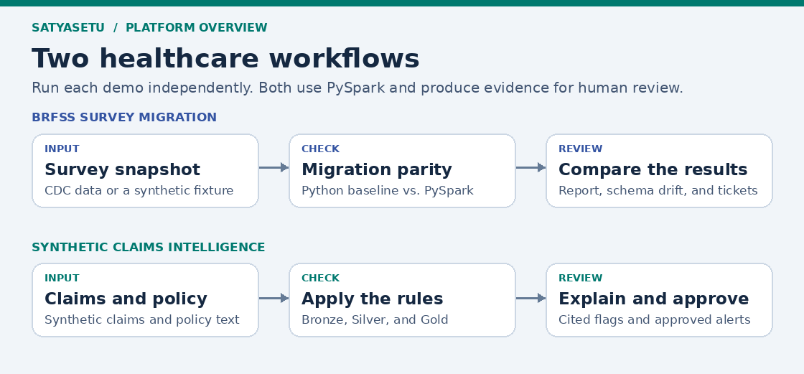
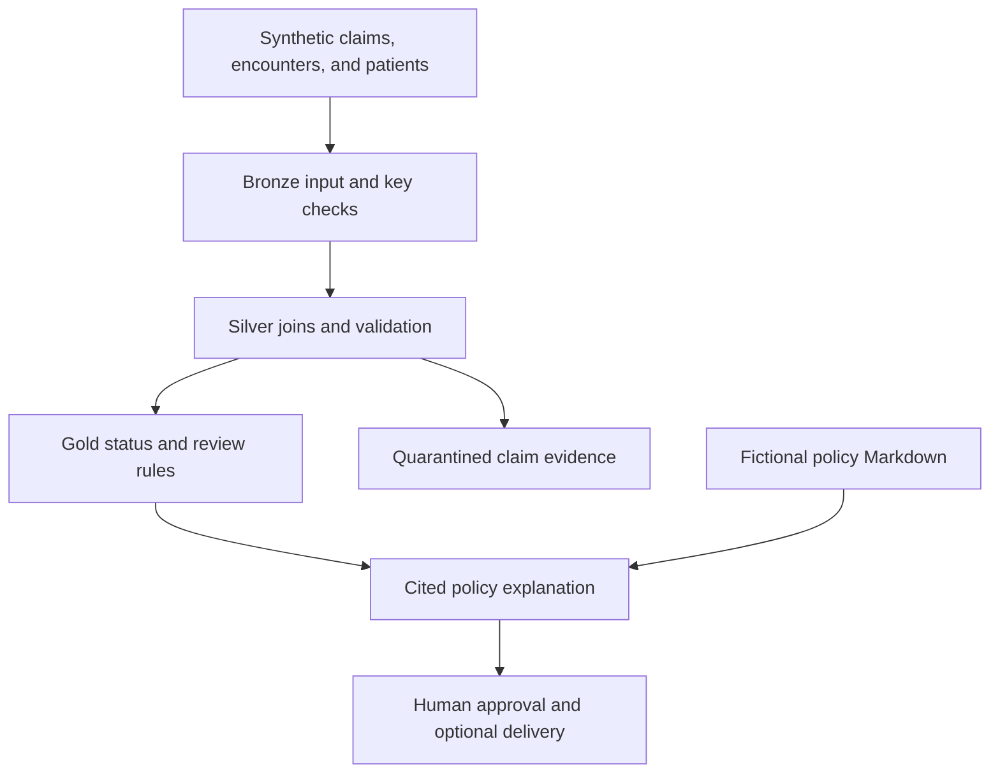

# SatyaSetu architecture

[Back to the README](../README.md)

The repository has two entry points. Both use PySpark and produce review evidence, but they use separate data, outputs, and SQLite queues.

| Concern | Survey migration | Claims intelligence |
|---|---|---|
| Input | CDC survey archives or synthetic fixture | Synthetic patients, encounters, claims, and a fictional policy |
| Processing | Independent Python baseline and target PySpark calculation | Bronze CSV projection, Silver validation and joins, Gold review rules |
| Evidence | Profile and metric comparisons, schema drift, year-specific codebooks | Status and rule IDs per claim, linked to fictional policy sections |
| Review | Requirements, reconciliation tickets, and BI/BA sign-off | Draft, human approval, and optional delivery through Logic Apps |
| Outputs | `out/fixture/` or `out/cdc/` | `out/claims/` |

## Claims workflow

Open the [BRFSS migration guide](brfss-migration.md) for the original survey architecture and reconciliation diagrams.
