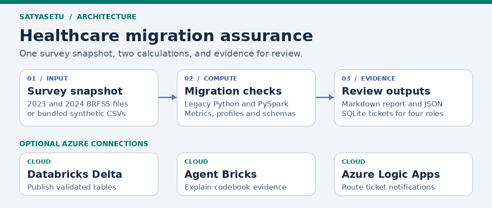
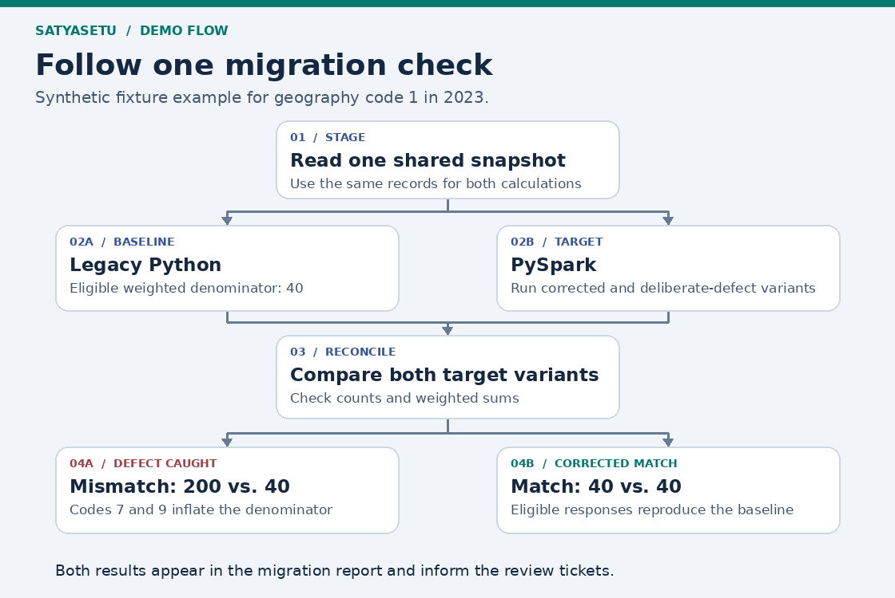

# SatyaSetu | BRFSS Survey Migration

[Back to the combined project README](../README.md)

SatyaSetu checks whether a healthcare dashboard still gives the same results after migration. The demo uses public CDC Behavioral Risk Factor Surveillance System (BRFSS) survey data for 2023 and 2024. An independent Python calculation simulates the legacy dashboard, and PySpark builds the target survey model and recalculates the weighted diabetes metric. Both calculations use the same staged records.

The project injects a denominator defect to show how a dashboard can look correct while quietly counting ineligible survey responses. It produces a migration report with the expected and actual values, then creates review tickets for BI/BA, Architect, Developer, and Tester. A separate requirement intake checks proposed changes against the target model and available source fields.



[Run the demo](#run-the-bundled-demo) · [See the migration flow](#migration-flow) · [Read the code](#follow-the-code) · [Push to GitHub](#push-to-github)

## Run the bundled demo

Use Python 3.11 or 3.12 and Java 17 or 21. From the extracted repository folder on Linux, macOS or WSL:

~~~bash
python3 -m venv .venv
source .venv/bin/activate
python -m pip install -e '.[local]'
brfss demo --fixture --out out/fixture
~~~

Expected output:

~~~text
Corrected: PASS (5 groups). Defect: FAIL (3 mismatches). Profile parity: PASS.
Report: out/fixture/migration_report.md
~~~

Open `out/fixture/migration_report.md`. For geography code 1 in 2023, the weighted denominator should be 40. The defective target includes codes 7 and 9 and produces 200, reducing the estimated prevalence from 25% to 5%. A failed defect scenario means the check caught the deliberate error.

## Migration flow



[Walk through the fixture from input rows to reviewer tickets](walkthrough.md).

## Follow the code

| Step | Source code | What to look for |
|---|---|---|
| Start the demo | [`cli.run_demo`](../src/brfss_assurance/cli.py#L62) | How the command stages inputs, runs both calculations, and writes evidence. |
| Stage the data | [`input_data.stage`](../src/brfss_assurance/input_data.py#L78) | Selected survey fields, row lineage, and the source manifest. |
| Build the baseline and target | [`legacy.calculate`](../src/brfss_assurance/legacy.py#L8) · [`spark_model.aggregate`](../src/brfss_assurance/spark_model.py#L35) | The independent calculations and the deliberate denominator defect. |
| Compare results | [`validation.reconcile`](../src/brfss_assurance/validation.py#L12) · [`source_schema_diff`](../src/brfss_assurance/validation.py#L45) | Same-snapshot metric checks and a separate comparison of the two survey-year schemas. |
| Assess and review | [`requirements.assess`](../src/brfss_assurance/requirements.py#L6) · [`report.migration_report`](../src/brfss_assurance/report.py#L24) · [`Tickets`](../src/brfss_assurance/tickets.py#L12) | The design verdict, reviewer views, and recorded decisions. |
| Retrieve evidence or notify | [Agent Bricks tool](../cloud/agent_bricks/review_tools.py#L18) · [`notify.dispatch`](../src/brfss_assurance/notify.py#L14) | Year-specific codebook lookup and optional notification delivery. |

The [PySpark denominator filter](../src/brfss_assurance/spark_model.py#L39-L40) is where the defect is injected:

```python
    allowed_codes = VALID_CODES + UNKNOWN_CODES if inject_defect else VALID_CODES
    eligible = positive & code.isin(allowed_codes)
```

With `inject_defect=True`, codes 7 and 9 enter the denominator. The reconciliation check exposes the change even though the numerator stays the same.

## Repository structure

```text
satyasetu/
├── README.md
├── pyproject.toml                      # Dependencies and the brfss command
├── .gitignore
├── .env.example                        # Logic Apps environment variable name
├── .github/workflows/ci.yml             # Synthetic demo and workflow checks
├── config/catalog.json                 # Target grain, keys and field mappings
├── data/sample/                        # Synthetic survey CSVs for 2023 and 2024
├── examples/                           # Migration and report-change requests
├── docs/                               # Walkthrough and diagram images
├── src/brfss_assurance/
│   ├── cli.py                          # Demo, assessment and review commands
│   ├── input_data.py                   # Read XPT and CSV data and stage fields
│   ├── legacy.py                       # Independent reference calculation
│   ├── spark_model.py                  # Target fact, profiling and Gold metric
│   ├── validation.py                   # Reconciliation and year-to-year schema drift
│   ├── requirements.py                 # Design checks and role assignments
│   ├── evidence.py                     # Year-specific codebook retrieval
│   ├── report.py                       # JSON evidence and Markdown report
│   ├── tickets.py                      # SQLite tickets and reviewer decisions
│   └── notify.py                       # Preview or dispatch notifications
├── cloud/
│   ├── databricks/                     # Publish validated tables to Delta
│   ├── agent_bricks/                   # Read-only retrieval and validation tools
│   └── logic_apps/                     # Request schema and workflow setup
└── tests/                              # Known-result and workflow checks
```

Git tracks the source code, configuration templates, documentation, and small test files. Create `data/raw/` locally for the four CDC archives. Reports, staged rows, and the review database appear under `out/` when you run the demo.

## Run the CDC files

The full release includes the two XPT ZIP archives and two codebook ZIP archives in `data/raw/`. Download them from the [2023 CDC source page](https://www.cdc.gov/brfss/annual_data/annual_2023.html) and [2024 CDC source page](https://www.cdc.gov/brfss/annual_data/annual_2024.html), or use the original files you already have. Rename the files to match the command or adjust the paths.

~~~bash
brfss demo \
  --source-2023 data/raw/LLCP2023XPT.zip \
  --source-2024 data/raw/LLCP2024XPT.zip \
  --codebook-2023 data/raw/codebook23_llcp-v2-508.zip \
  --codebook-2024 data/raw/codebook24_llcp-v2-508.zip \
  --out out/cdc
~~~

Omit `--limit-per-year` to process the complete archives. Use `--limit-per-year 10000` for a faster QA slice. A file-order slice is useful for checking the pipeline. Run full inputs for prevalence analysis. XPT ingestion spools one archive member at a time to a temporary file, so leave about 2 GB free in the temporary filesystem. If Spark cannot resolve your WSL hostname, run `export SPARK_LOCAL_IP=127.0.0.1`.

| Output | Evidence |
|---|---|
| `migration_report.md` | Architecture, model mapping, parity verdict, and BI/BA, Architect, Developer, Tester views |
| `manifest.json` | Archive hashes, row counts, source columns, and any limit applied |
| `data_profile.json` | Legacy input and target fact profiles, including coded missing values and survey weights |
| `reconciliation_defect.json`, `reconciliation_corrected.json` | Expected and actual values by year and geography |
| `schema_drift.json` | Added and removed survey-year fields |
| `assessment.json`, `tickets.sqlite` | Design verdict, findings, and persistent reviewer queue |
| `codebook_index.json`, `retrieved_evidence.json` | Searchable annual codebook sections and cited passages |
| `notification_preview.json` | Role-based ticket notification payloads |

The full CDC run processed **433,323 records for 2023** and **457,670 for 2024**. The corrected calculation matched the baseline in all **105 geography and year groups**, and the data profiles matched. The deliberate denominator error triggered a failure in all 105 groups. The 2024 file added 61 fields and removed 110 relative to the 2023 file. Both years retained the fields required for the demo diabetes metric.

## Review a new requirement

Edit a copy of [examples/migration.json](../examples/migration.json) or use one of the supplied change requests. Migration intake asks for the legacy architecture summary, model grain and keys, fields, and the reference report or calculation. Describe a real legacy system in those fields if you have one. The bundled legacy system is a simulation.

~~~bash
brfss assess --request examples/missing_legacy.json --out out/intake
brfss assess --request examples/unsupported_grain.json --out out/intake
brfss assess --request examples/year_extension.json \
  --manifest out/cdc/manifest.json --out out/intake
~~~

| Design verdict | Meaning |
|---|---|
| `SUITABLE` | The request passes the supported intake checks. |
| `NEEDS_CLARIFICATION` | A reviewer needs to resolve a missing field, baseline, mapping, or acceptance criterion. |
| `UNSUITABLE_AS_PROPOSED` | A constraint such as an unsupported reporting grain blocks the proposed design. |

Execution validation records a separate `PASS` or `FAIL` based on the comparison. For a real migration, replace the simulated reference calculation with an independent legacy baseline and reconcile against the same approved source snapshot and filters.

Use a new requirement version when the scope or baseline changes and a fresh output folder for each independent demo. Assessment checks structured request fields and catalog metadata. Architecture diagrams and SQL DDL can accompany a real intake, with their details entered in the structured fields for this version.

## Review tickets and codebook evidence

| Role | Review task |
|---|---|
| BI/BA | Confirm the metric definition and approve the final reconciliation. |
| Architect | Review the table grain, keys, field mappings, and schema changes. |
| Developer | Investigate mismatches and document corrections. |
| Tester | Rerun reconciliation and confirm that the acceptance checks pass. |

~~~bash
brfss tickets --out out/cdc
brfss notify --out out/cdc
brfss evidence DIABETE4 --year 2023 --out out/cdc
~~~

Copy a ticket ID from the list. For the fixture run, substitute `out/fixture` for `out/cdc`.

~~~bash
brfss decide TICKET_ID --out out/cdc --role DEVELOPER \
  --actor "Demo reviewer" --decision APPROVED \
  --note "Verified corrected denominator in the parity report"
~~~

Review the other assigned tickets before BI/BA metric sign-off. Ticket IDs are stable for a requirement version and finding. The CLI simulates role assignment and records the reviewer, decision, evidence note, and timestamp.

## Azure connections

| Component | Included setup |
|---|---|
| Databricks and Delta | [Publish the validated fact, dimensions and Gold summary](../cloud/databricks/README.md) |
| Agent Bricks and RAG | [Add read-only codebook and validation tools to a LangGraph scaffold](../cloud/agent_bricks/README.md) |
| Logic Apps | [Configure the request trigger and four role-based notification branches](../cloud/logic_apps/README.md) |

The PySpark pipeline, codebook search, assessment, tickets, and notification preview run locally. Azure connections require a configured workspace, permissions, and connectors. The Agent Bricks folder supplies two read-only tools for an agent you scaffold in your workspace. The Logic Apps folder supplies the request schema and designer steps for role-based delivery.

## Data model and metric

The target grain is **one survey response row per input interview**. `survey_year + source_row` identifies a row within the staged snapshot. It is a lineage key, with the snapshot hash recorded in the manifest. The target preserves geography, response code, final weight, stratum, and primary sampling unit. Gold uses one row per survey year and geography.

The demo point estimate is **100 × weighted yes / weighted eligible**. Code 1 contributes to the numerator. Codes 1 through 4 with positive weights contribute to the denominator. Codes 7 and 9, missing responses, and unusable weights are excluded. Staging rounds the weight to eight decimal places before both implementations run, allowing exact reconciliation of the weighted sums. The demo calculates a point estimate for migration verification. Use approved survey methods and the survey design variables for uncertainty estimates or published surveillance results.

## Push to GitHub

Extract the ZIP and open the inner `satyasetu` folder in WSL. Use your existing GitHub repository named `satyasetu`. If it is empty, run the following commands and replace `YOUR_USERNAME` with your GitHub username.

~~~bash
git init -b main
git add .
git status --short
git commit -m "Add SatyaSetu BRFSS migration assurance"
git remote add origin https://github.com/YOUR_USERNAME/satyasetu.git
git push -u origin main
~~~

If your GitHub repository already has commits, clone it first. Copy the project files into the clone, review any files with matching names, then commit and push from the clone. If you already initialized the project locally and added `origin`, update it with `git remote set-url origin https://github.com/YOUR_USERNAME/satyasetu.git`.

Use your GitHub credential manager or sign in with `gh auth login`. GitHub Actions runs the synthetic fixture and workflow tests. The four public source archives are tracked. Generated output, review state, and secrets are excluded by `.gitignore`.
